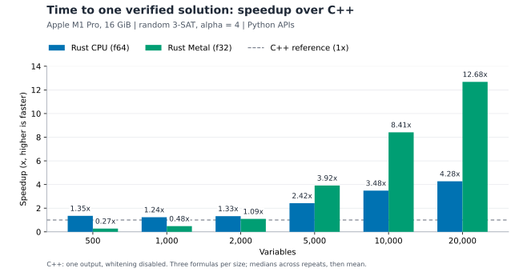

# Apple M1 Pro benchmark

[Back to the quickstart](README.md)

## Speed comparison: Apple M1 Pro

The C++ counterpart is [Carlo Nicolini's pybsp](https://github.com/CarloNicolini/pybsp),
based on [Raffaele Marino's original BSP code](https://github.com/raffaelemarino/The-Backtracking-Survey-Propagation-Algorithm-code).
The following Python API measurements were collected on 2026-10-29 using an
**Apple M1 Pro with 16 GiB unified memory**, macOS 26.5.2, and Python 3.12.12.
Inputs are random 3-SAT formulas in the easy regime, with **alpha = 4** and
exactly `4N` clauses. Both CPU implementations run on one thread.

**Every column measures time to one verified solution.** The C++ benchmark uses
an isolated Release rebuild requesting one WalkSAT completion, with post-solution
whitening disabled. Its stock API collects ten assignments after a shared BSP
reduction; dividing that batch time by ten would not measure first-solution
latency. All 57 C++ calls reproduced the original batch's first assignment and
BSP sweep count. All 171 calls in the one-solution comparison passed an independent
clause check; Metal reported no CPU fallback.

| Variables | BSP.rs CPU (s) | BSP.rs Apple GPU / Metal (s) | C++ pybsp, one solution (s) |
| ---: | ---: | ---: | ---: |
| 500 | 0.298 | 1.470 | 0.403 |
| 1,000 | 1.122 | 2.876 | 1.387 |
| 2,000 | 3.095 | 3.753 | 4.103 |
| 5,000 | 10.348 | 6.391 | 25.055 |
| 10,000 | 21.087 | 8.733 | 73.474 |
| 20,000 | 42.499 | 14.331 | 181.735 |

At 20,000 variables, BSP.rs CPU is **4.28x faster than C++**, and Metal is
**12.68x faster than C++**, or **2.97x faster than BSP.rs CPU**. BSP.rs CPU is the
fastest option through 2,000 variables in this sample; Metal is fastest from 5,000 onward.

Bars show `C++ seconds / BSP.rs seconds`; values above the dashed 1x reference
favor BSP.rs. CUDA has no bar because it was not measured in this comparison.

Each row averages the per-formula median times for three shared formulas.
Small cases have six repetitions per formula at 500 variables and five at
1,000–2,000; larger cases have one call per formula. Timing includes solver setup,
search, synchronization, and Python result conversion, excluding formula
construction and discarded warmups. Rust CPU and Metal were measured in the
initial campaign; C++ was rebuilt and measured in a later campaign. CPU uses
`f64`, while Metal uses `f32` and can follow a different search trajectory.
These results describe this hardware and sample.

See the [benchmark report and correctness audit](bench/results/easy_alpha4_20261029/REPORT.md),
[plot data](bench/data/apple_m1_pro_alpha4.csv), and
[SVG generator](bench/plot_easy_regime.py) for the measurements and reproduction details.
