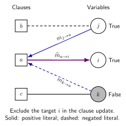

Belief propagation before survey propagation
============================================

A distribution over assignments
-------------------------------

Assume there is at least one satisfying assignment and consider the uniform
measure on satisfying configurations:

.. math::

   \mu(\mathbf x)=\frac{1}{Z}
   \prod_a\psi_a(\mathbf x_{\partial a}),
   \qquad
   Z=\sum_{\mathbf x}\prod_a\psi_a(\mathbf x_{\partial a}).

Here Z counts assignments, not clusters. A marginal :math:`\mu_i(x_i)` asks
how often a variable takes a value under this assignment measure. Belief
propagation (BP), or sum-product message passing, approximates such marginals
using local cavity distributions. The broader connection to statistical
inference and Bethe approximations is reviewed in [ZK2016]_.

Two message directions
----------------------

Let :math:`m_{i\to a}(x_i)` be the distribution of variable i when constraint
a is removed, and :math:`\widehat m_{a\to i}(x_i)` be the compatibility message
from clause a. Factorization of independent branches gives

.. math::
   :label: bp-variable

   m_{i\to a}(x_i)=\frac{1}{Z_{i\to a}}
   \prod_{b\in\partial i\setminus a}\widehat m_{b\to i}(x_i),

.. math::
   :label: bp-clause

   \widehat m_{a\to i}(x_i)=\frac{1}{\widehat Z_{a\to i}}
   \sum_{\mathbf x_{\partial a\setminus i}}
   \psi_a(\mathbf x_{\partial a})
   \prod_{j\in\partial a\setminus i}m_{j\to a}(x_j).

The Z factors normalize each two-component message. On a factor tree these
equations follow by summing disjoint subtrees. For a positive-support measure,
messages from leaves determine exact marginals after information has propagated
across the tree. Hard constraints require consistent support: a zero
normalization signals incompatible boundary conditions.

   The same signed incidence supports messages in both directions. An outgoing
   clause message excludes its target variable; an incoming variable message
   excludes the receiving clause. Colors show example truth values only, not
   message probabilities. Arrows indicate the update's direction and leave
   solid/dashed literal signs intact. Other neighbors of b and c are omitted.

For a clause, let :math:`u_{j\to a}` be BP's probability that j violates its
literal in a. The clause is already satisfied when i takes its satisfying value,
so the corresponding unnormalized factor message is 1. When i violates its
literal, the factor message is :math:`1-\prod_{j\ne i}u_{j\to a}`. Thus BP
reduces a local sum over configurations to a product for an OR clause. A
variable marginal is obtained from the product over **all** incident clauses,
followed by normalization.

What changes on a loopy graph?
------------------------------

On a graph with cycles, deleting one edge does not generally make neighboring
branches independent. Iterating BP treats them as approximately independent.
A converged fixed point need not produce exact marginals; convergence itself
is not guaranteed. Sparsity and locally tree-like neighborhoods motivate the
approximation but do not eliminate long-range correlations.

In a clustered solution space, a global assignment measure can combine many
internally correlated states. A single local distribution may conceal that a
variable is forced True in some states, forced False in others, and variable
within still others. An ordinary marginal of one-half can arise from very
different state structures. This motivates passing distributions of state-level
information rather than replacing every branch by a single assignment marginal.

Warnings and surveys
--------------------

A zero-energy clause warning is a binary statement: all its other literals
are forced to violate the clause, so this variable must satisfy it. Warning
propagation passes such state-level logical messages. Survey propagation passes
their distributions across states, closing them with a cavity factorization
assumption [BMZ2005]_ [BMWZ2003]_.

BP and SP therefore differ in their modeled objects and weighting. SP is not
obtained by merely running the BP scalar probabilities with a different
tolerance, nor by averaging arbitrary BP iterates. BSP.rs implements the SP
warning-survey equations in the next chapter; it does not expose a BP solver.
