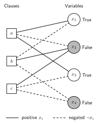

The problem: satisfiability on a sparse factor graph
====================================================

From Boolean decisions to constraints
-------------------------------------

Let :math:`x_i\in\{0,1\}` for :math:`i=1,\ldots,N`. A CNF formula is a
conjunction of clauses, each a disjunction of signed literals:

.. math::
   :label: cnf

   F(\mathbf x)=\bigwedge_{a=1}^{M}
   \left(\bigvee_{i\in\partial a}\ell_{ai}(x_i)\right),
   \qquad
   \ell_{ai}(x_i)=
   \begin{cases}x_i,&\text{positive incidence},\\
   1-x_i,&\text{negative incidence}.\end{cases}

The search task is to find one vector satisfying every clause. Verifying a
candidate requires evaluating the incidences, whereas discovering a candidate
can require a much harder search. General SAT has no known efficient complete
algorithm; BSP.rs supplies a heuristic with verified successes and explicit
failure states. Failure does not prove unsatisfiability.

For example, consider

.. math::

   (x_1\lor\neg x_2\lor x_3)
   \land(\neg x_1\lor x_2\lor\neg x_4)
   \land(x_2\lor\neg x_3\lor\neg x_4).

The assignment :math:`(1,0,1,0)` satisfies all three clauses. In Python this is
``Formula([[1,-2,3],[-1,2,-4],[2,-3,-4]], n=4)``.

   Signed bipartite factor graph for the example. Clauses are always on the
   left; variables are on the right. White fill means True and grey fill means
   False. Edge style encodes the **literal sign**, independently of the current
   truth value: solid for positive, dashed for negated. Labels also identify
   truth values so the diagram does not rely on fill alone.

Why a bipartite graph?
----------------------

The neighborhood :math:`\partial a` contains the variables in clause a;
:math:`\partial i` contains its incident clauses. An edge is a literal
incidence, not an interaction between two variables. This representation keeps
the local constraint and its sign explicit and supports local message updates.
Use :math:`\partial_+ i` and :math:`\partial_- i` for positive and negative
incidences of variable i. Removing an edge defines a **cavity** neighborhood.

The sparse graph matters computationally: if the number of incidences is E,
one properly organized SP sweep takes work proportional to the graph's
incidences plus its vertices. Clause widths and variable degrees determine
parallelism and memory access. This statement concerns a sweep, not the number
of sweeps or decisions required to solve a problem.

The statistical-mechanics formulation
-------------------------------------

Write :math:`\psi_a(\mathbf x_{\partial a})=1` for a satisfied clause and
0 otherwise, and define the number of violated clauses as an energy:

.. math::

   H(\mathbf x)=\sum_a[1-\psi_a(\mathbf x_{\partial a})],
   \qquad
   \mu_\beta(\mathbf x)=Z_\beta^{-1}\exp[-\beta H(\mathbf x)].

If satisfying assignments exist, the zero-temperature limit concentrates on
them. One can then ask about marginals, how the solution set is organized,
and which variables constrain many possible completions. These are different
questions from merely checking one assignment. The cavity perspective on
random satisfiability connects these questions to algorithm design [MZ2002]_.

In random k-SAT every clause has k distinct variables, independent signs, and
:math:`M=\lfloor\alpha N\rfloor`. The ratio alpha controls constraint density.
Locally tree-like sparse graphs motivate message passing, but loops and global
correlations remain. The code also accepts mixed-width formulas; theoretical
claims specific to the random ensemble do not automatically extend to them.

Approaches to solving SAT
-------------------------

Complete methods such as branching with logical inference can establish SAT
or UNSAT, with potentially large worst-case cost. Local search moves among
complete assignments using the violated clauses as a guide. Message-passing
decimation instead estimates local preferences and builds a partial assignment.
BSP combines the latter with the ability to undo selected decisions, then uses
focused local search to complete a residual problem [SAO2005]_.

The next chapters first derive ordinary belief propagation on a factor graph,
then explain why surveys over state-level warnings lead to the SP equations
actually implemented here. This route separates an assignment distribution,
a distribution over clusters, and the practical decimation policy.
