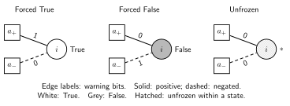

Survey propagation: the implemented equations
=============================================

From assignment marginals to state-level information
----------------------------------------------------

In the cavity description, satisfying configurations may organize into states
or clusters with internally correlated variables. In one state, variable i may
be forced True, forced False, or remain unfrozen. These are statements about
variation **within a state**, not about whether the program has already fixed
the variable. A free solver variable can have a strongly forced survey.

The conceptual state-level partition function is
:math:`\mathcal Z(m)=\sum_\gamma Z_\gamma^m`, with :math:`Z_\gamma` the
number of assignments in state gamma. Equal assignment weighting and equal
state weighting differ when state sizes differ. The cluster-counting,
hard-field SP closure used here corresponds to the m=0 perspective, rather
than evaluating this expression for general m. States are a cavity-model
description; the solver does not enumerate them or construct connected
components of the full solution graph [BMWZ2003]_ [MZ2002]_.

   Three admissible hard-warning configurations. Solid edges are positive,
   dashed edges negative; the edge labels are warning bits. Hatched fill marks
   an unfrozen variable, distinct from white=True and grey=False. Simultaneous
   positive and negative warnings are incompatible. This is a schematic of
   states, not a measured population or a claim that the three cases are equally
   likely. Clause boxes summarize incident constraints with other neighbors omitted.

The two cavity quantities
-------------------------

For each directed clause incidence a to i define
:math:`\eta_{a\to i}\in[0,1]`, the probability across cavity states that a
warns i: every other literal in a is forced to violate a, so i must satisfy it.
This is the Python ``messages`` array. A warning on a negative literal demands
False; eta itself is not a True marginal or the probability that a clause is
unsatisfied.

Define the internal variable-to-clause quantity :math:`q_{i\to a}` as the
survey probability that i is forced to the value **violating its literal in a**.
It is not exposed as a separate Python array. The cavity independence closure
then gives the clause update [BMZ2005]_

.. math::
   :label: sp-clause

   \widehat\eta_{a\to i}
      =\prod_{j\in\partial a\setminus i}q_{j\to a}.

The product excludes the target, and uses messages computed from the same old
iterate. This exclusion prevents a clause from immediately reinforcing its own
warning through a variable.

Same-sign and opposite-sign exclusion products
----------------------------------------------

Relative to the literal of i in a, split its other incident clauses into
:math:`\mathcal S_{ia}` (same sign) and :math:`\mathcal O_{ia}` (opposite
sign), always excluding a. Define the probability of no incoming warning in
each group:

.. math::

   P^{\rm same}_{i\to a}
      =\prod_{b\in\mathcal S_{ia}}(1-\eta_{b\to i}),\qquad
   P^{\rm opp}_{i\to a}
      =\prod_{b\in\mathcal O_{ia}}(1-\eta_{b\to i}).

An empty product is one. To force i to violate a, there must be at least one
opposite-sign warning and no same-sign warning. Configurations carrying both
types of warnings are inconsistent. Conditioning on the remaining cases gives

.. math::
   :label: sp-cavity

   z_{i\to a}=P^{\rm opp}_{i\to a}
       +(1-P^{\rm opp}_{i\to a})P^{\rm same}_{i\to a},\qquad
   q_{i\to a}=\frac{(1-P^{\rm opp}_{i\to a})P^{\rm same}_{i\to a}}
                         {z_{i\to a}}.

These equations can be read directly against the scalar Rust cavity routine:
``same``, ``opposite``, and ``norm`` are the two products and z. Independent
incoming warnings and the exclusion of inconsistent combinations are modeling
assumptions, not consequences of convergence on a loopy finite graph.

For example, with :math:`P^{\rm same}=0.8` and :math:`P^{\rm opp}=0.6`,
the compatible weight is 0.92 and :math:`q=0.32/0.92\simeq0.347826`.
If the other cavity variable of a 3-clause has q=0.2, its outgoing warning
to the target is about 0.069565. This is a product of **forcing** probabilities,
not the BP product of ordinary probabilities of false literals.

Full variable surveys
---------------------

Using all active incidences, set

.. math::

   P_i^+=\prod_{a\in\partial_+i}(1-\eta_{a\to i}),\qquad
   P_i^-=\prod_{a\in\partial_-i}(1-\eta_{a\to i}),\qquad
   Z_i=P_i^+ + P_i^- - P_i^+P_i^-.

The three compatible events are: at least one positive warning and none
negative; at least one negative warning and none positive; and no warning.
Their normalized surveys are

.. math::
   :label: sp-surveys

   S_i^T=\frac{(1-P_i^+)P_i^-}{Z_i},\qquad
   S_i^F=\frac{(1-P_i^-)P_i^+}{Z_i},\qquad
   S_i^0=\frac{P_i^+P_i^-}{Z_i}.

Their sum is one when the normalization is positive. ``surveys[i]`` is exactly
the ordered vector :math:`[S_i^T,S_i^F,S_i^0]`, refreshed after convergence.
With :math:`P_i^+=0.8` and :math:`P_i^-=0.6`, the vector is approximately
``[0.130435, 0.347826, 0.521739]``. Its free entry is a fraction of states with
no forcing, not a third Boolean truth value.

Complexity versus entropy
-------------------------

The implementation evaluates the cluster-counting Bethe expression using
the final cavities. For active degree :math:`d_i`, let

.. math::

   z_a=\left(\prod_{i\in\partial a}z_{i\to a}\right)
       \left(1-\prod_{i\in\partial a}q_{i\to a}\right),\qquad
   \Sigma=\sum_a\log z_a-\sum_i(d_i-1)\log Z_i.

All sums and products refer to the residual active/free graph. This is the
**total** complexity estimate; :math:`\Sigma/N` would be a density. The
heuristic interpretation is :math:`\mathcal N_{\rm states}\approx e^\Sigma`,
not the number of satisfying assignments. It neither supplies a rigorous
integer count nor includes every state's internal entropy. An invalid
normalization or non-finite expression causes an explicit numerical failure.

The code's ``paramagnetic`` flag is true when every free variable of active
degree at least two has :math:`Z_i=1` in the evaluated arithmetic. It then
reports complexity zero and hands the residual to WalkSAT. This algebraic
criterion is a practical handoff rule; it does not prove the residual is SAT.

Iteration, damping, and numerical care
--------------------------------------

One synchronous sweep computes all q values from old eta values, then all raw
clause updates from those q values. The implementation thresholds raw products
below :math:`10^{-16}` to zero and applies damping

.. math::

   \eta^{t+1}=\widehat\eta^{t+1}
             +d(\eta^t-\widehat\eta^{t+1}),\qquad
   R_t=\max_{(a,i)}|\widehat\eta_{a\to i}^{t+1}-\eta_{a\to i}^t|.

The stopping criterion is :math:`R_t\le\epsilon`; it is deliberately
undamped. Normalizers and surveys are recomputed from the final stored messages,
rather than reusing cavities from the preceding iterate.

Prefix/suffix products compute exclusions without dividing by a potentially
zero factor. Nevertheless, finite precision can underflow a positive product
or create an unusable denominator. GPU f32 modes detect dangerous cases and
retry on CPU f64. Numerical agreement, fixed-point convergence, accuracy of
the state-factorization approximation, and probability of finding a solution
are four separate questions; each needs its own evidence.
