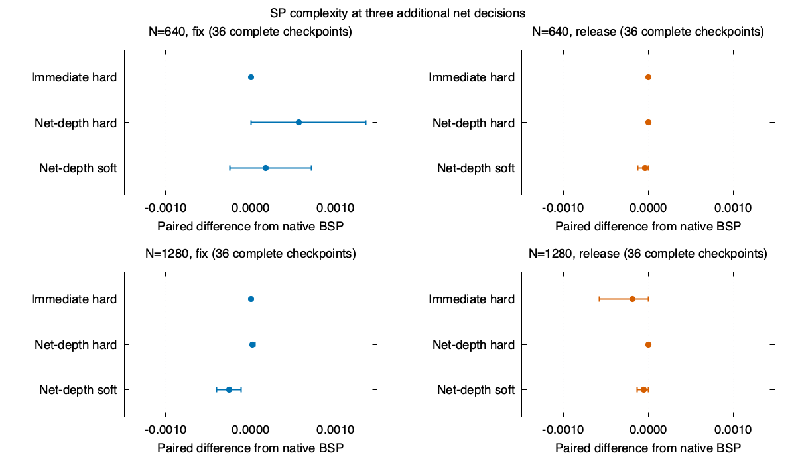

# BSP continuation at fixed net decimation depth

This experiment follows PR #70's first pilot. Candidate moves are compared
at the first converged point with three additional fixed decisions relative
to the root. Fixing and then releasing the same variable therefore cannot
satisfy the endpoint by itself. Unit assignments are excluded from the
depth count. The experiment uses single-variable interventions and leaves
native multi-release batches intact.

[Protocol](NET_PROTOCOL.md) · [Development](net_results/development.json) ·
[Holdout](net_results/heldout.json) · [Predictor](net_results/predictor.json)

## Hardware and budgets

Apple M1 Pro, 8 cores, 16 GB, macOS arm64 (Darwin 27.2.0), Rust 1.99.1
(58cf8f9c3), Cargo release with locked dependencies. The measured campaigns
use six workers with the scalar f64 CPU backend. Wall times describe
concurrent runs, including contention. Compare sweep counts directly.
All charged sweeps, including unsuccessful speculative branches, share
one 1.5M-sweep cap. Each SP solve has a 16,384-sweep cap at epsilon 1e-5.
The action cap is 16,000 and the WalkSAT cap is 4M flips. Relative to the
first pilot, these are 25, 32, 32 and 62.5 times larger respectively.
Epsilon is one order of magnitude looser. The original negative-complexity
guard remains in effect.

Metal completed 1,000 sweeps on N=1280, alpha=9.45 in 0.202 s with no
fallback, compared with 0.300 s for the scalar CPU in a one-off sweep
probe. These timings exclude solver construction. This was an engineering
probe, with two available builds of the CLI and f32 GPU messages. It gives
no paired evidence about policy outcomes or a general speedup.

## Matched checkpoints

All 144 held-out checkpoints reached the requested net depth for all three
first actions. The median continuation took 12 native moves after a fix and
16 after a release. At 121 of the 144 checkpoints, the spread across the
three endpoint complexity values was below 1e-6 in absolute units.
Immediate undo was observed in 285 of 432 first-action branches.

Mean paired change versus the native action, in total SP complexity:

| Size | Phase | Immediate hard at first move | Immediate hard at net depth | Net hard at net depth | Net soft at net depth |
|---:|---|---:|---:|---:|---:|
| 640 | Fix | +0.000065 | ~0 | +0.000564 | +0.000175 |
| 640 | Release | +0.005414 | ~0 | 0 | −0.000042 |
| 1280 | Fix | +0.000061 | ~0 | +0.000015 | −0.000257 |
| 1280 | Release | +0.004306 | −0.000192 | 0 | −0.000055 |

Net hard uses the measured endpoint as part of its score. Its endpoint
contrast is the gain attainable with that evaluated shortlist and score,
and is not an independent test of an inexpensive predictor. The fitted
relative predictor failed to improve on predicting zero in all four strata.
The native follow-up usually converges to near-identical complexity after
the different first moves. Both persistence and the ability to distinguish
candidates need to be tested when using this objective.



## Closed-loop search

| Policy | SAT at N=640 | SAT at N=1280 | Median sweeps at N=640 | Median sweeps at N=1280 |
|---|---:|---:|---:|---:|
| Native | 1/12 | 1/12 | 153,884 | 387,380 |
| Immediate hard | 1/12 | 1/12 | 155,323 | 393,157 |
| Net-depth hard | 2/12 | 1/12 | 203,957 | 457,038 |
| Net-depth soft | 2/12 | 2/12 | 200,647 | 372,211 |

All three experimental policies solved both native successes. Net hard
and net soft additionally solved seed 305 at N=640. Net soft additionally
solved seed 306 at N=1280. These are two discordant paired formulas for
net soft versus native, with a two-sided exact McNemar p-value of 0.50.
All policies solved the same four development formulas. At N=1280,
median speculative work was about 90,066 sweeps for net hard and 76,200
for net soft. Differences in total work also reflect when each trajectory
stopped. No primary run exceeded 608,553 SP sweeps in the held-out cohort.

The selected density had one native success out of two at N=1280 in the
calibration. The independent sample had one out of 12. The paired
end-to-end comparison is therefore limited by a low baseline SAT rate
and a small number of discordant outcomes. The useful next test is a
pre-specified intermediate-success regime calibrated with more seeds.
A candidate value estimator could predict the chance of a verified
handoff under a fixed work budget, where rare trajectory differences
remain visible even when net-depth complexity agrees.

## Resource sensitivity

None of the completed primary trajectories hit the global sweep or action
cap. The 40M-flip replay preserved the BSP path up to handoff in all eight
flip-limited trajectories. All eight still reached the WalkSAT cap. Of the
18 native trajectories with a nonconverged SP stop, increasing the
fixed-point cap to 65,536 passed the original stop in four. One of those
four produced a verified SAT assignment and three stopped at later SP
points. The other 14 stopped at the original move. This sensitivity analysis
uses the same native policy and epsilon. It does not diagnose the dynamics
behind the remaining nonconvergence.

## Reproduce

```sh
cargo build --locked --release
python3 experiments/soft_bsp/net_calibrate.py target/release/bsp-rust /tmp/bsp-cal
experiments/soft_bsp/run_net.sh development /tmp/bsp-development 6
experiments/soft_bsp/run_net.sh heldout /tmp/bsp-heldout 6
experiments/soft_bsp/run_net.sh replay-flips /tmp/bsp-heldout 2
experiments/soft_bsp/run_net.sh replay-sp /tmp/bsp-heldout 3
python3 experiments/soft_bsp/net_calibration.py /tmp/bsp-development /tmp/bsp-heldout
python3 experiments/soft_bsp/net_plot.py /tmp/bsp-heldout/summary.json /tmp/net-depth.png
```

The raw archive includes exact DIMACS formulas and SAT witnesses. It can be
extracted to recompute the summaries with `net_analysis.py` and
`net_calibration.py`. The analysis independently checks every SAT witness.

## Interpretation of complexity and search

The checkpoint comparisons condition on the native trajectory reaching a
converged single-move state. They identify counterfactual changes for
those states. Closed-loop SAT counts include all formulas and classify
every stop. Higher SP complexity can coexist with a harder residual.
The learned predictor is an offline estimate of relative complexity
within the native shortlist. Its error and rank regret do not measure
the likelihood of solving the resulting CNF.

The immediate and continuation arms intervene sparsely. Their end-to-end
differences combine changes in move choices, later trajectory divergence,
and speculative cost. The sample gives paired case counts at two sizes
and does not estimate an asymptotic threshold.
