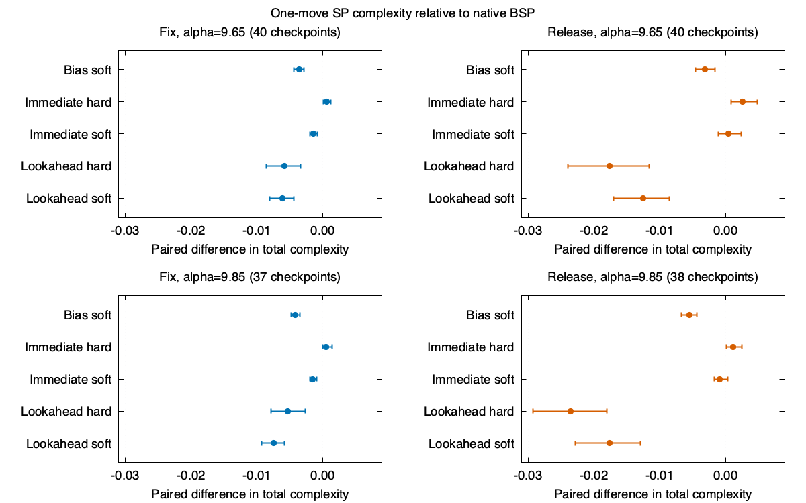

# Entropy-regularized BSP on random 4-SAT

Eight pilot formulas and 40 held-out formulas, at (N=160), `alpha=9.65`
and `9.85`. Scalar f64 on an Apple M1 Pro (8 cores, 16 GB), macOS arm64,
Rust 1.99.1 (58cf8f9c3), Cargo release profile and locked dependencies, base
commit `d920af22cb60ac884ac4952aa0428a6e6847b3e4`. MiniSat 2.2.1 used a
one CPU-second limit per query. Campaigns used 4 pilot workers and 6 holdout
workers, with one scalar solver per worker. Sweep counts are the budget
metric. Wall times include inter-worker contention and exclude diagnostic
checkpoint evaluation, and support descriptive comparisons only.

## Complexity at common checkpoints

The held-out analysis used 155 of 160 planned checkpoints. Every immediate
child converged. Values below are mean paired differences from the native
move in total SP complexity after one move. Higher is better for both
phases. Fix usually gives a negative change, while release gives a positive
change. The resampling unit for the intervals in `heldout.json` is the
formula, with checkpoints averaged within each formula.

| Policy | Fix 9.65 (40) | Release 9.65 (40) | Fix 9.85 (37) | Release 9.85 (38) |
|---|---:|---:|---:|---:|
| Native mean signed change | −0.05910 | +0.05952 | −0.06439 | +0.06186 |
| Bias soft minus native | −0.00362 | −0.00311 | −0.00418 | −0.00552 |
| Immediate hard minus native | +0.00058 | +0.00258 | +0.00053 | +0.00111 |
| Immediate soft minus native | −0.00142 | +0.00046 | −0.00151 | −0.00086 |
| Lookahead hard minus native | −0.00583 | −0.01758 | −0.00535 | −0.02359 |
| Lookahead soft minus native | −0.00614 | −0.01256 | −0.00751 | −0.01766 |



At temperature 0.01, immediate soft lost roughly 0.002 complexity units
relative to immediate hard in all four strata. Two-step hard lookahead
recovered +0.00240 and +0.00150 over native after a common native follow-up
on fix checkpoints. At four steps, these differences were −0.00137 and
−0.00147. Release differences at four steps for hard lookahead were close
to zero. The four-step replay is a post-hoc diagnostic.

## Continuation and reversals

571 of 618 branches with a converged second report (92.4%) returned to
the exact pre-move partial assignment by undoing the same move. Two other
branches failed to yield a converged second report. At the two-step
horizon, `-delta_sigma` had a lower held-out MAE than zero, a phase/density
mean, and a linear regression fitted on the pilot, in all four strata.
The benefit was driven by immediate reversals. For 9.65 fixes, mean absolute
two-step net change was 0.00177 for reversal branches and 0.04384 for the
other branches. The replay distinguishes matching assignments from matching
SP states because frozen messages and the next fixed point can still differ.

The complexity part of the two-step objective telescopes. A higher
complexity immediately after a release can disappear on refix. Testing
future policies should therefore use a longer progress horizon, verify
whether the next decision undoes the previous one, and track a terminal
objective such as SAT under a fixed budget.

## End-to-end budget

Across 40 held-out formulas none of the seven policies found SAT within
60,000 SP sweeps, 500 moves and the stated WalkSAT limit. The unrestricted
native smoke run solved one of the two smoke formulas. In the pilot, one
of eight formulas was solved under each of native, bias-soft and sparse
lookahead. All reported witnesses were independently checked against
archived DIMACS clauses by the analysis script. Dense lookahead exhausted
the sweep budget on 38 of 40 held-out formulas. Sparse lookahead reduced
that count to 14, compared with 5 for native. All other outcomes retain
their solver status in the summaries. MiniSat classified 3 of 155 holdout
parents and 10 of 620 children SAT, with the rest unknown at the oracle
budget. The oracle therefore cannot establish effects on SAT preservation.

The best immediate scoring policy evaluated four candidate moves and reused
the selected child's point. The two-step policy evaluated up to eight
additional points. These costs were charged even when the evaluated child
was never selected. The search comparison is underpowered for SAT because
the chosen size, densities and budget yielded zero baseline successes
on held-out formulas. It does establish the observed sweep overhead and
the early-checkpoint complexity effects.

## Reproduce

Run from the checkout root. Use a fresh output directory for each run.

```sh
experiments/soft_bsp/run.sh smoke /tmp/soft-bsp-smoke
experiments/soft_bsp/run.sh pilot /tmp/soft-bsp-pilot 4
experiments/soft_bsp/run.sh heldout /tmp/soft-bsp-heldout 6
experiments/soft_bsp/run.sh diagnostic /tmp/soft-bsp-diagnostic 4
python3 experiments/soft_bsp/continuation.py /tmp/soft-bsp-pilot /tmp/soft-bsp-heldout \
  --diagnostic /tmp/soft-bsp-diagnostic
```

Put MiniSat on PATH or set `SOFT_BSP_MINISAT`. The measured diagnostic
replay omitted MiniSat because oracle values do not enter the replay
analysis. The archive contains JSONL, exact DIMACS formulas and SAT
witnesses. In its extracted layout, run `analyze.py pilot --expected 8`,
`analyze.py heldout --expected 40`, and
`continuation.py pilot heldout --diagnostic diagnostic` to recover the
published JSON. Verify `results/SHA256SUMS` from the results directory.

## Next experiment

Start with a regime that has intermediate baseline success probability at
the intended budget. Freeze that regime on new development seeds. Calibrate
progress value over several net decisions or fixed work, explicitly
conditioning on immediate undo. Compare the cheap continuation estimate
with immediate hard and two-step lookahead at the same sweep cap. Keep
the difference between fix loss and release gain as secondary diagnostics.
Use enough independent formula seeds to resolve the target change in
verified SAT rate before considering an implementation for normal solving.
